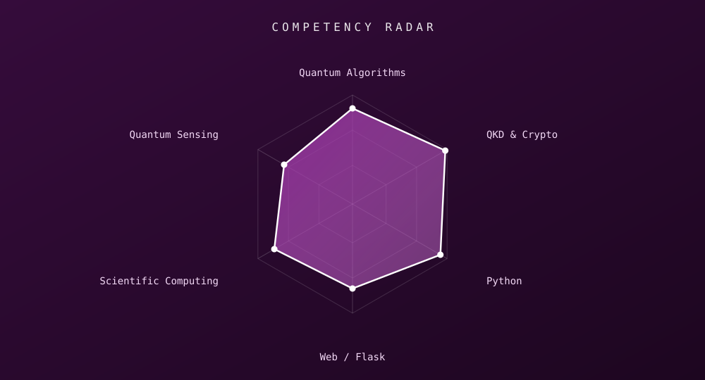

<!-- ===================== HERO ===================== -->

  

  

  
  
  
  

<!-- ===================== 01 ABOUT ===================== -->

  

### *“Our bodies are complex; our thinking doesn't have to be. Keep it simple. Use common sense.”*

I'm **Agha Tasheer Syedi** — an **M.Tech Quantum Computing** scholar at **DIAT–DRDO, Pune**, specialising in **Quantum Communication & Sensing**. My work sits at the intersection of **QKD, quantum algorithms, quantum networking, quantum metrology, and post-quantum cryptography** — built with Qiskit, QuTiP, and reproducible scientific software.

<!-- ===================== 02 RESEARCH FOCUS ===================== -->

  

<table>
  <tr>
    <td width="50%" valign="top">

#### 🔐 Quantum Key Distribution
Decoy-state **BB84** with signal / decoy / vacuum states. Polarisation encoding, QBER estimation, and secure-key-rate analysis against photon-number-splitting attacks.

   </td>
    <td width="50%" valign="top">

#### 📡 Quantum Communication & Sensing
Electro-optic modulation, polarisation control, attenuation and channel characterisation — with a metrology-first view of the optical layer.

   </td>
  </tr>
  <tr>
    <td width="50%" valign="top">

#### 🧮 Quantum Algorithms & Simulation
Shor, Grover, and variational eigensolvers in **Qiskit**; open-system dynamics and decoherence modelling in **QuTiP**.

   </td>
    <td width="50%" valign="top">

#### 🌐 Quantum Networking
Quantum communication, entanglement distribution, quantum network simulation, and quantum repeaters.
   </td>
  </tr>
</table>

  

<!-- ===================== 03 TECH STACK ===================== -->

  

  

  
  
  
  
  
  
  
  
  
  
  
  

<!-- ===================== 04 SELECTED WORK ===================== -->

  

<table>
  <tr>
    <td width="50%" valign="top">

### 🔷 [AQCA](https://github.com/aghasyedi/aqca)
**All Quantum Computing Algorithms** — an educational atlas of **19 algorithms, protocols & stabiliser codes**, with derivations and live circuit demos.

`Python · Qiskit · JS · MathJax`
🔗 [Live](https://aqca.netlify.app/) · [Code](https://github.com/aghasyedi/aqca)

   </td>
    <td width="50%" valign="top">

### 🔶 [BB84 QKD Simulator](https://github.com/aghasyedi/bb84-simulator)
Browser BB84 with photon transmission, **Cascade / LDPC reconciliation**, Toeplitz privacy amplification, and eavesdropping visualisations.

`JS · HTML5 Canvas · KaTeX`
🔗 [Live](https://bb84qkd.netlify.app/) · [Code](https://github.com/aghasyedi/bb84-simulator)

   </td>
  </tr>
  <tr>
    <td width="50%" valign="top">

### 🟣 [EduPresence LMS](https://github.com/aghasyedi/EduPresence)
Full-stack learning platform with role-based access, **face / QR attendance**, Google OAuth, and Jitsi Meet integration.

`Flask · PostgreSQL · OpenCV`
🔗 [Code](https://github.com/aghasyedi/EduPresence)

   </td>
    <td width="50%" valign="top">

### 🎓 M.Tech Dissertation · *in progress*
**Decoy-State BB84 QKD** — experimental framework for polarisation encoding, optical modulation, QBER and secure-key-rate analysis.

`Qiskit · QuTiP · Lab`
🔗 *Ongoing*

   </td>
  </tr>
</table>

<!-- ===================== 05 EDUCATION ===================== -->

  

  

<b>🎓 Academic Record</b>

- **M.Tech, Quantum Computing** — *Quantum Communication & Sensing*
  **DIAT–DRDO, Pune** · Expected Jun 2027 · **CGPA 8.35**
  *Coursework:* Quantum Communication · Quantum Computing · Quantum Metrology & Sensing · Classical & Post-Quantum Cryptography · Quantum Optics

- **B.Tech, Computer Science & Engineering**
  **SHUATS, Prayagraj** · 2021 – 2025 · **CGPA 8.11**
  *Coursework:* Software Engineering · Blockchain Technology · Cryptography

<b>💼 Experience</b>

- **PHP & MySQL Intern** — LPS Web Technology · Sep – Dec 2023
- **Web Design Intern** — A Vingenious Technologies · Jun – Aug 2023

<!-- ===================== 06 ACHIEVEMENTS ===================== -->

  

- 🥇 **GATE Qualified (Computer Science)** — 2024 & 2025
- 🎓 **AICTE Postgraduate Scholarship** — awarded to GATE-qualified M.Tech students

<b>📜 Certifications</b>

- **Hands-on Quantum Error Correction** — Google Quantum AI · 2026
- **Foundations of Quantum Mechanics** — University of Colorado Boulder · 2025
- **Understanding Modern Physics II: QM & Atoms** — HKUST · 2025
- **Electrodynamics: An Introduction** — KAIST · 2026
- **FPGA Architecture & Programming** — NIELIT Calicut · 2025

<!-- ===================== 07 CONTACT ===================== -->

  

  
  
  
  
  

---

  
    
  <i>“In the quantum realm, reality is a superposition — until observed.”</i> 🔬
    
  

